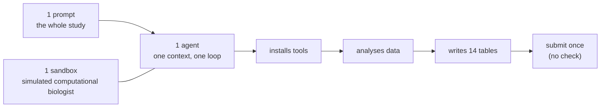
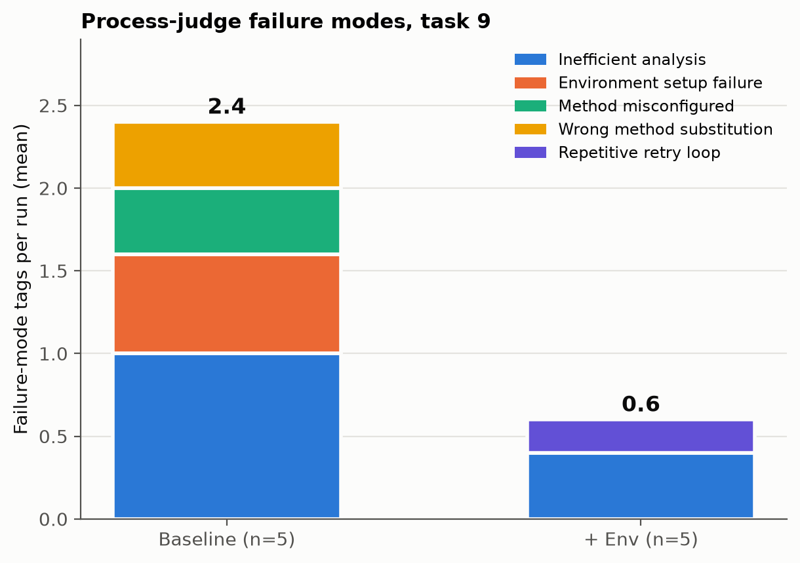
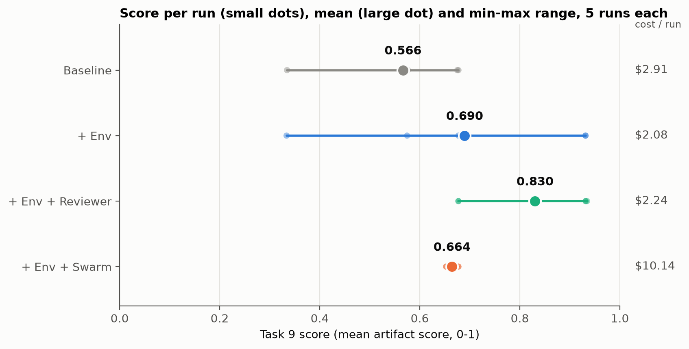
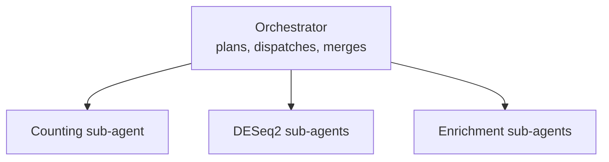
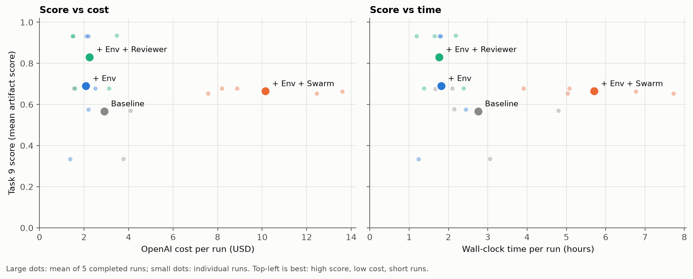

# How to leverage AI agents to autonomously reproduce the research of a bio paper

**From raw sequencing reads to the paper's published result tables, with no human in the loop.**

*AI Research Hackathon, Track 3: AI Scientist Swarms* · **[▶ Watch the 2-minute presentation](https://htmlpreview.github.io/?https://github.com/timothe-chaumont/BixBench3/blob/main/docs/presentation/BixBench3_Task9_Harness.html)**
([source](docs/presentation/BixBench3_Task9_Harness.html))

> **The challenge.** [BixBench3](https://arxiv.org/abs/2608.25286) asks whether AI agents can take the raw data of a
> published biology paper and reproduce its results on their own. Today's best model scores **0.48**, and an average
> attempt takes **6.8 hours and 102 million tokens**. We kept the model fixed and asked: **what harness should surround
> it?**

| | Result (task 9, 5 runs per variant) |
|---|---|
| **1 · Agent-tailored environment** | Failure modes **−75%**; runs about 30% cheaper and faster |
| **2 · Reviewer agent** | Score **+47%** (0.566 → 0.830) at **lower cost** than the baseline. The best variant. |
| **3 · Swarm of agents** | No higher score, but runs **25× more stable**, at about 5× the cost |

---

## Methodology: one paper, one baseline, five runs per variant

- **One paper: task 9.** Loss of REST in glioblastoma (T98G) and HEK293 cells. Raw Tag-Seq reads in, **14 result tables
  out**, each graded against the published table. The tables cover the count matrix, 9 differential-expression
  contrasts, shared-gene sets and GO enrichments.
- **One benchmark model.** GPT-5.4 Mini at `xhigh` reasoning, run in the paper's own single-agent harness. That is our
  baseline.
- **Repeated runs.** Every variant runs **5 times**. The same setup can score 0.33 in one run and 0.93 in the next, so we
  measure stability, not a lucky draw.
- **Same budget for everyone.** 6 CPU / 32 GB per run (the benchmark's cloud VM shape) on identical Stanford Sherlock
  nodes. We built a Sherlock runner for this.
- **Score.** The mean of the 14 per-table grader scores (0–1). We also report the paper's pass rate: the share of tables
  scoring at least 0.80.

## The previous method: one agent does everything



One generalist agent installs its tools, analyses the data, writes every table and submits. Nothing checks its work. We
changed the harness around it one idea at a time.

## Result 1 · Agent-tailored environment: failure modes −75%

We gave the agent an environment built for the job: the exact tools and versions the method requires, preinstalled.
These are HISAT2 2.2.1, Subread, DESeq2 1.30.1, clusterProfiler and the matching annotation packages. The agent no longer
burns its context on installs.

<p align="center"></p>

| Metric | Baseline → + Env |
|---|---|
| Failure-mode tags per run (process judge) | **2.4 → 0.6 (−75%)** |
| Setup and wrong-method errors per run | **1.4 → 0** |
| Mean score | 0.566 → 0.690 (+22%; not significant with 5 runs, p = 0.16) |
| Cost and time per run | $2.91 → $2.08 · 2.8 h → 1.8 h (about −30%) |

## Result 2 · Reviewer agent: the score rises 47% at no extra cost

Before a table is accepted, a **reviewer agent** checks it against the table's specification. The reviewer is a second
call to the same model and sees a computed summary of the file: shape, header, first and last rows, key checks. It
**never sees ground truth or grader output**. If the table is wrong, the agent gets written feedback and fixes it.

<p align="center"></p>

| Metric | Baseline → + Env + Reviewer |
|---|---|
| Mean score | **0.566 → 0.830 (+47%)**; exact permutation test, p = 0.012 |
| Worst of 5 runs | **0.335 → 0.677 (2.0×)** |
| Pass rate (the paper's task score) | 0.39 → **0.76**, above the paper's single GPT-5.4 Mini run on this task (0.71) |
| Cost per run | $2.91 → **$2.24** |

## Result 3 · Swarm of agents: no higher score, but 25× more stable



In the swarm, an orchestrator hands each table to its own specialist sub-agent.

| Metric | + Env (one agent) → + Env + Swarm |
|---|---|
| Run-to-run spread (max − min score) | **0.60 → 0.024 (25× tighter)**: all 5 runs fall between 0.653 and 0.677 |
| Mean score | 0.690 → 0.664 (no gain) |
| Cost and time per run | $2.08 → $10.14 (about 5×) · 1.8 h → 5.7 h (about 3×) |

**A finding about the benchmark itself.** The official process judge reads only the top-level conversation. It gave every
swarm run **0 failure tags**, while the sub-agents made **810–1,757 actions it never saw**. Re-judged on the full trace,
every swarm run is flagged. Multi-agent systems need full-trace grading.

## The full picture: the reviewer wins on score, cost and time

<p align="center"></p>

The reviewer sits top-left: the best score at the lowest cost and time. The swarm is the tight cluster on the right.

## Going forward: make swarms as cheap as they are stable

The swarm's stability is a strong prior. A trace audit of a finished swarm run ($8.88, 17 sub-agents) shows where its
cost goes:

- **Token consumption:** 268 polling calls, made while one sub-agent waited for a genome index to build, cost **$3.18,
  36% of the run**. That one sub-agent made 377 of the run's 747 model calls.
- **Memory management:** about **200 of the 810 tool calls** re-read what another agent already knew, such as the
  environment manifest, the sample mapping and upstream tables. A shared memory (past.dev) looks
  promising.
- **Agent orchestration:** conventions must travel between agents. 2 tables were rebuilt because a shared convention
  never reached their briefs.

We are testing these fixes now. **Swarm v5** uses blocking waits, parallel dependency levels and sub-agents at medium
effort. Its first finished runs cost about **$3–4 instead of $10**, with the same score. This is preliminary: 4 of 10 runs
are done. Reviewer and swarm variants with past.dev memory are still running.

One more lesson from the logs: most of the remaining error on T98G comes from one ambiguous sentence in the task
(*"Run DESeq2 separately by cell line and clone contrast"*). It leads agents to fit a different statistical design from
the paper's.

---

## Dig deeper

- **[Full task 9 analysis](results/task9/):** all figures (per-table heatmap, failure modes, cost and time),
  statistics, caveats, and the scripts that regenerate every figure from [raw per-run data](results/task9/data/runs.jsonl).
- **[Task 11 results](results/task11/):** the check that our Sherlock runner matches the cloud setup (0.630 ± 0.069
  against 0.679).
- **Each variant's branch:** exactly what changed (`experiments/<version>.md`) and per-run numbers (`RESULTS.md`).
  See the branch map below.

<details>
<summary><b>How we ran it (identical for every variant)</b></summary>

- **Model and limits:** GPT-5.4 Mini at `xhigh` reasoning, the official v1.0.0 task prompt, 24 h / 5,000-message limits.
- **Grading:** the official BixBench3 grader and process judge.
- **Hardware:** 6 CPU / 32 GB per run, on identical AMD EPYC 7502 Sherlock nodes.
- **Statistics:** exact one-sided permutation tests against the baseline, 5 runs vs 5. Reviewer: p = 0.012 on mean score
  and p = 0.024 on pass rate. Environment: p = 0.16 / 0.20. Swarm: p = 0.07 / 0.42.
- **Which runs count:** every completed run, whatever its score. Runs killed by infrastructure problems (API rate limit, a
  relay outage) are excluded, as are smoke tests. They are lost runs, not agent results. Variants with fewer than 5
  finished runs are marked preliminary and make no claims.
- **Paper numbers:** quoted, never estimated. The paper reports 0.48 for the best model, 6.8 h and 102 M tokens per
  attempt on average, and one GPT-5.4 Mini run on task 9 (10 of 14 tables passed).
- **Swarm judging:** swarm failure tags come from the same judge re-run on the full trace. The official `judge.json`
  files are unchanged.

</details>

<details>
<summary><b>Infrastructure we built</b></summary>

- **Sherlock runner** ([`sherlock/runner`](https://github.com/timothe-chaumont/BixBench3/tree/sherlock/runner)): runs the unchanged benchmark on Stanford's HPC cluster
  with the cloud VM shape. Sandbox parity fixes: root apt, memory and CPU views, isolation from host processes. A key
  relay switches OpenAI keys mid-run without interrupting the agent. Up to 24 runs at once.
- **Preinstalled task environments** ([`feat/task-envs-sherlock`](https://github.com/timothe-chaumont/BixBench3/tree/feat/task-envs-sherlock)): per-task images with the
  tool versions the method asks for.
- **Live dashboard** ([`tools/bixdash`](tools/bixdash/)): every run's phase, cost and score, shared across the team.
- **6 vCPU team profile** ([TEAM_SETUP.md](TEAM_SETUP.md)) and the adapted GCP runner ([ADAPTED_RUNNER.md](ADAPTED_RUNNER.md)).
- **Task 11 "lite" proxy study** ([iterations/proxy-validation-task11](iterations/proxy-validation-task11/)): can a
  30-minute downstream-only task stand in for the 2-hour full run? It is feasible, but ranking preservation is not
  established.

</details>

<details>
<summary><b>Branch map: one branch per experiment</b></summary>

| Branch | What it adds | Status |
|---|---|---|
| `main` | Benchmark code, team setup, [results/](results/), run records ([iterations/](iterations/)), [presentation](docs/presentation/) | |
| [`exp/t9-baseline`](https://github.com/timothe-chaumont/BixBench3/tree/exp/t9-baseline) | Task 9 baseline | 5/5 runs done |
| [`exp/t9-env`](https://github.com/timothe-chaumont/BixBench3/tree/exp/t9-env) | + agent-tailored environment | 5/5 done |
| [`exp/t9-env-reviewer`](https://github.com/timothe-chaumont/BixBench3/tree/exp/t9-env-reviewer) | + reviewer agent (**best**) | 5/5 done |
| [`exp/t9-env-subagents`](https://github.com/timothe-chaumont/BixBench3/tree/exp/t9-env-subagents) | + swarm: orchestrator and sub-agents (v4) | 5/5 done |
| [`exp/t9-env-subagents-v5`](https://github.com/timothe-chaumont/BixBench3/tree/exp/t9-env-subagents-v5) | Swarm v5: the cost fixes | 1/5 done, running |
| [`exp/t9-env-subagents-v5-pastdev`](https://github.com/timothe-chaumont/BixBench3/tree/exp/t9-env-subagents-v5-pastdev) | Swarm v5 + past.dev shared memory | 3/5 done, running |
| [`exp/t9-env-subagents-pastdev`](https://github.com/timothe-chaumont/BixBench3/tree/exp/t9-env-subagents-pastdev) | Swarm v4 + past.dev shared memory | running |
| [`exp/t9-env-reviewer-pastdev`](https://github.com/timothe-chaumont/BixBench3/tree/exp/t9-env-reviewer-pastdev) | Reviewer that remembers the tables it already accepted | running |
| [`exp/t9-env-reviewer-dual-pastdev`](https://github.com/timothe-chaumont/BixBench3/tree/exp/t9-env-reviewer-dual-pastdev) | Local reviewer + consistency reviewer with memory | running |
| [`exp/t11-baseline`](https://github.com/timothe-chaumont/BixBench3/tree/exp/t11-baseline) | Task 11 baseline on Sherlock | 4/4 done |
| [`exp/v2f`](https://github.com/timothe-chaumont/BixBench3/tree/exp/v2f), [`exp/v3a`](https://github.com/timothe-chaumont/BixBench3/tree/exp/v3a)–[`v3e`](https://github.com/timothe-chaumont/BixBench3/tree/exp/v3e) | Task 11 batch 1 harness variants on GCP | single runs, see [results/task11](results/task11/) |
| [`exp/t11-v4-dag-orchestrator`](https://github.com/timothe-chaumont/BixBench3/tree/exp/t11-v4-dag-orchestrator) | First sub-agent orchestrator (source of t9 v4) | code only |
| [`sherlock/runner`](https://github.com/timothe-chaumont/BixBench3/tree/sherlock/runner), [`feat/task-envs-sherlock`](https://github.com/timothe-chaumont/BixBench3/tree/feat/task-envs-sherlock) | Sherlock runner; per-task environment images | infrastructure |
| [`setup/adapted-runner`](https://github.com/timothe-chaumont/BixBench3/tree/setup/adapted-runner), [`tools/bixdash`](https://github.com/timothe-chaumont/BixBench3/tree/tools/bixdash) | Earlier snapshots, already merged into `main` | archived |

</details>

**Run the benchmark yourself:** see the upstream documentation below, [TEAM_SETUP.md](TEAM_SETUP.md) for GCP and
[`sherlock/runner`](https://github.com/timothe-chaumont/BixBench3/tree/sherlock/runner) for HPC. Upstream baseline commit `d0e0bbb41222335b1b8878f533a58466a3a782dc`.

---

# BixBench3 (upstream documentation)

BixBench3 evaluates whether AI agents can reproduce research-scale computational biology analyses from public raw data. Each task supplies a biological objective, method guidance, raw inputs, and exact structured output contracts. Agents run on a GCP VM, analyze the data, and produce the required artifacts. Agent artifacts are graded deterministically against published ground truth artifacts, and a PhDval-compatible process judge scores instruction following, transparency, analytical rigor, and run-level failure modes.

This repository contains the public runner and grader code. The 20-task benchmark is on huggingface [BixBench3 Hugging Face dataset](https://huggingface.co/datasets/EdisonScientific/BixBench3). Raw inputs data and ground truth artfiacts are stored Google Cloud Storage buckets.

```text
BixBench3 github repo  
└── runner code, grader code

Hugging Face  EdisonScientific/BixBench3
├── prompts + artifact output contracts
├── cases/{paper_id}/agent/ 
├── cases/{paper_id}/runtime/
└── manifests/   (task map, GCS package URLs)

GCS inputs   gs://bixbench3-inputs/releases/v1.0.0/tasks/{paper_id}/
├── data/raw/         agent-visible raw inputs (FASTQs, etc.)
└── data/metadata/    non-answer metadata

GCS ground truth   gs://bixbench3-ground-truth/releases/v1.0.0/tasks/{paper_id}/
├── artifacts_grading.json   which checks (F1, CCC, ...) each artifact uses
└── artifacts/               golden published tables used for grading
```


# Running the benchmark


## 1. Install prerequisites

Install Python 3.12, `uv`, and the Google Cloud CLI. Clone this repository and install its locked dependencies:

```bash
git clone https://github.com/EdisonScientific/BixBench3.git
cd BixBench3
uv sync --locked
```


## 2. Authenticate a GCP project

Authentice with Google Cloud CLI:

```bash
gcloud auth login
gcloud config set project YOUR_PROJECT
```

The project must have billing and the Compute Engine API, and quota for an `n2-standard-32` VM in `us-central1-a` (or change the code to use your desired region). 

## 3. Export API keys

Export the provider key for the model you want to test. The benchmark network adjudicator and process judge use GPT-5.5, so every run also requires `OPENAI_API_KEY`.

```bash
export OPENAI_API_KEY=...
export ANTHROPIC_API_KEY=...
```

Other supported provider variables are `GOOGLE_API_KEY` and `OPENROUTER_API_KEY`. Keys are accepted only through environment variables and are streamed into memory on the VM. 

## 4. Obtain licensed 10x software

For use in the agent's docker container, download [Cell Ranger 6.0.2](https://www.10xgenomics.com/support/software/cell-ranger/downloads/previous-versions) and [Cell Ranger ARC 2.0.2](https://www.10xgenomics.com/support/software/cell-ranger-arc/downloads/previous-versions) from 10x Genomics after reviewing and accepting its End User Software License Agreement. This repository does not host or redistribute the tarballs, and BixBench3 does not verify that you accepted the license.

Expected files:

```text
cellranger-6.0.2.tar.gz
cellranger-arc-2.0.2.tar.gz
```


## 5. Build the runtime (done once)

```bash
uv run bixbench3 setup-runtime \
  --project YOUR_PROJECT \
  --cellranger-tarball /path/to/cellranger-6.0.2.tar.gz \
  --cellranger-arc-tarball /path/to/cellranger-arc-2.0.2.tar.gz
```

This creates a VM which builds and tests the Docker image, stores it as a private image in your project, and then deletes the VM. The image is versioned with the benchmark release. Each agent runs inside this image in subsequent runs.

The build typically takes 30–60 minutes. Add `--dry-run` to validate the archives and inspect the planned cloud operations without creating resources.

## 6. Run a task

```bash
uv run bixbench3 run \
  --task 1 \
  --model openai/gpt-5.5 \
  --effort max \
  --project YOUR_PROJECT \
  --results-bucket gs://YOUR_BUCKET/bixbench3 # optional
```

On the first run of a task, the runner copies that task's raw input data from `gs://bixbench3-inputs` onto a persistent disk in your GCP project, checks the disk against the expected checksum, and attaches it read-only to the VM where the agent will run. Later runs of the same task reuse that disk in your project instead of re-downloading from GCS.

After provisioning the VM, `run` starts the benchmark as a detached service and returns. It prints a run ID and exact commands for checking, completing, or cancelling the run. Your workstation does not need to remain connected. Runs take up to 24 hours, with an average of approximately 8 hours.

### Run outputs and retention

Local outputs are stored under `runs/{paper_id}/{model_slug}/{timestamp}/`. When `--results-bucket gs://BUCKET/PREFIX` is set, retained cloud outputs are uploaded under `gs://BUCKET/PREFIX/{paper_id}/{model_slug}/{timestamp}/`.


| Output                                   | Contents                                                                 | Without `--results-bucket`                      | With `--results-bucket`                                       |
| ---------------------------------------- | ------------------------------------------------------------------------ | ----------------------------------------------- | ------------------------------------------------------------- |
| `grade.json`                             | Overall paper score and all artifact results                             | Downloaded locally by `complete`                | Downloaded locally and uploaded to GCS                        |
| `judge.json`                             | PhDval-compatible process score, rubric evidence, and failure-mode tags  | Downloaded locally by `complete`                | Downloaded locally and uploaded to GCS                        |
| `artifact_grades/`                       | One grading JSON file per requested artifact                             | Downloaded locally by `complete`                | Downloaded locally and uploaded to GCS                        |
| `inspect_logs/`                          | Inspect eval log, trajectory, model events, and available usage metadata | Downloaded locally by `complete`                | Downloaded locally and uploaded to GCS                        |
| `run_manifest.json`                      | Local run identity, model settings, lifecycle state, and cleanup result  | Retained locally                                | Retained locally; the remote manifest is also uploaded to GCS |
| `remote_run_manifest.json`               | Final manifest copied back from the VM                                   | Downloaded locally by `complete`                | Downloaded locally; represented as `run_manifest.json` in GCS |
| `cleanup.json`                           | VM deletion result                                                       | Written locally by `complete` or `cancel`       | Written locally by `complete` or `cancel`                     |
| `outputs/`                               | Files written directly by the agent                                      | Deleted with the VM                             | Uploaded to GCS                                               |
| `agent_artifacts/`                       | Agent outputs copied into the deterministic grading input directory      | Deleted with the VM                             | Uploaded to GCS                                               |
| `broker_logs/`                           | Network gateway request and adjudication logs                            | Deleted with the VM                             | Uploaded to GCS                                               |
| `workspace/`                             | Agent working files and approved web downloads                           | Deleted with the VM                             | Deleted with the VM                                           |
| `broker_cache/` and `broker/policy.json` | Network cache and effective access policy                                | Deleted with the VM                             | Deleted with the VM                                           |
| `dataset/`                               | Staged one-task prompt and runtime metadata                              | Deleted with the VM                             | Deleted with the VM                                           |
| `host_ground_truth/`                     | Temporary host-only grading package                                      | Removed after grading, then deleted with the VM | Removed after grading, then deleted with the VM               |
| `run.sh` and `status.json`               | Detached service script and live phase state                             | Deleted with the VM                             | Deleted with the VM                                           |
| `/dev/shm/bixbench3.env`                 | In-memory provider API keys                                              | Deleted when the run exits                      | Deleted when the run exits                                    |


## 7. Monitor and grade a task

```bash
uv run bixbench3 status \
  --run RUN_ID \
  --project YOUR_PROJECT

uv run bixbench3 complete \
  --run RUN_ID \
  --project YOUR_PROJECT
```

You can check the status of a run with `status` and grade it with `complete`.

`status` is read-only and reports the remote phase, exit status, and VM state, including the `grading` and `judging` phases that follow the analyst run. Once it reports `succeeded` or `failed`, run `complete` to copy `grade.json`, `judge.json`, the `artifact_grades/` directory, Inspect logs under `inspect_logs/`, and the final manifest locally and delete the VM. The VM remains running and billable until you complete or cancel it.

To stop an active run, collect any available state, and delete its VM:

```bash
uv run bixbench3 cancel \
  --run RUN_ID \
  --project YOUR_PROJECT
```

By default, `complete` copies the overall `grade.json`, process report `judge.json`, per-artifact JSON files under `artifact_grades/`, Inspect logs under `inspect_logs/`, and the run manifest to your local machine. Pass `--results-bucket` when launching to also upload agent outputs, the copied agent artifacts, network broker logs, and the same grade, judge, and Inspect files to a GCS prefix you already own. Without this option, those additional run files are lost when `complete` or `cancel` deletes the VM. The project's default Compute Engine service account must be able to write to that bucket.

### Process judging

Every cloud run automatically invokes `openai/gpt-5.5` with requested effort `max` (resolved to `xhigh`) and temperature 0 after deterministic artifact grading. The implementation pins the same prompt, eight per-artifact rubrics, ten failure-mode tags, trace compaction, response schema, normalization, and single validation retry used by PhDval-1. A process-judge API or parsing failure is recorded in `judge.json` without replacing or invalidating the deterministic artifact grade.

### Grading existing artifacts

```bash
uv run bixbench3 grade \
  --task 1 \
  --artifacts-dir /path/to/outputs
```

The command prints the overall paper score, every artifact score, and each output path. It writes the overall result to `grade.json` beside the supplied artifacts directory and writes one JSON file per artifact under `artifact_grades/`.

## Model effort

Every run requires an explicit effort. `src/bixbench3/reference_models.yaml` records the exact models and non-effort settings used in the paper.

- OpenAI GPT-5.6 models preserve native `max` with high verbosity. GPT-5.5 and earlier models resolve `max` to `xhigh` with high verbosity.
- Google and Gemini `max` or `xhigh` resolve to `high`.
- OpenRouter GLM 5.2 and DeepSeek V4 Flash resolve `max` to `xhigh`.
- Grok 4.5 resolves `max` or `xhigh` to its highest supported effort, `high`.
- OpenRouter Kimi K3 preserves `max`.
- Claude Fable 5, Claude Opus 5, Claude Opus 4.8, and Claude Sonnet 4.6 use `--effort max`. Claude Fable 5 does not set Anthropic `fallbacks`, so a classifier content restriction is returned as a refusal instead of retrying another model.
- Claude Haiku 4.5 uses 63,999 reasoning tokens for `max`.

The run manifest records both the requested and resolved effort.

## Tasks

Task numbers map to stable paper IDs in the Hugging Face release manifest:

1. `10.1101_2025.06.17.659900_v1` — The chromatin remodeler LET-418/Mi-2 regulates the intracellular pathogen response in the C. elegans intestine
2. `10.64898_2026.02.11.704850_v1` — Contact-dependent regulation of UV-B/C-induced cell fate by neighbouring intact cells
3. `10.1101_2025.08.16.670679_v1` — An interneuronal CRH and CRHBP circuit stabilizes birdsong performance
4. `10.64898_2026.02.03.703548_v1` — How many are you? Open data and bioinformatics reveal species misidentification and potential introgression in Chordodes
5. `10.1101_2025.07.20.665670_v1` — A conserved small RNA-generating gene cluster undergoes sequence diversification and contributes to plant immunity
6. `10.1101_2025.07.08.663208_v1` — MitoPerturb-Seq identifies common and gene-specific single-cell responses to mitochondrial DNA depletion and heteroplasmy
7. `10.1101_2025.07.28.666515_v1` — Methylomic signatures of tau and amyloid-beta in transgenic mouse models of Alzheimer's disease neuropathology
8. `10.1038_s42003-022-03654-9_v1` — Combined MEK and JAK/STAT3 pathway inhibition effectively decreases SHH medulloblastoma tumor progression
9. `10_1186_s12915_024_01879_0_v1` — Targeting of REST with rationally-designed small molecule compounds exhibits synergetic therapeutic potential in human glioblastoma cells
10. `10.1038_s41467-023-44243-6_v1` — Structure-guided design of a selective inhibitor of the methyltransferase KMT9 with cellular activity
11. `10.1016_j.crtox.2021.01.003_v1` — Transcriptomic analyses of livers from mice exposed to 1,4-dioxane for up to 90 days to assess potential modes of action underlying liver tumor development
12. `10.1101_2025.06.02.657493_v1` — A microbiota-derived bile acid modulates biofilm formation by the probiotic strain Escherichia coli Nissle 1917
13. `10.64898_2026.03.10.709901_v1` — High-resolution retrospective single cell lineage tracing with mutable homopolymers
14. `10.1101_2025.07.21.665972_v1` — RUNX2 inhibition disrupts a PAX3::FOXO1-RUNX2 feed-forward loop and dismantles oncogenic gene programs in fusion-positive rhabdomyosarcoma
15. `10.64898_2026.01.09.698641_v1` — TDP-43 dysfunction leads to the accumulation of cryptic transposable element-derived exons, crypTEs, in iPSC derived neurons and ALS/FTD patient tissues
16. `10.1101_2025.07.31.667834_v1` — Antifungal exposure can enhance Candida glabrata pathogenesis
17. `10.1101_2025.07.18.664654_v1` — Polycomb repression works without Siesta
18. `10.64898_2026.01.02.697332_v1` — A Glycosylation-Dependent Checkpoint Restrains Intestinal Intra-Epithelial Lymphocyte Activation
19. `10.64898_2026.01.31.702960_v1` — A TCER-1-siRNA Regulatory Axis Suppresses Antibacterial Innate Immunity in C. elegans
20. `10.64898_2026.02.04.703711_v1` — Habitat fragmentation controls bacterial community composition outcomes


## License

Edison-authored code and benchmark materials are licensed under CC BY-SA 4.0. Mirrored raw scientific data and published artifacts retain their original upstream terms (see `NOTICE`).
## Outils

- [`tools/bixdash`](tools/bixdash/) : dashboard des runs (collecteur en lecture seule sur chaque VM, site web, import des runs terminés). Voir son README.
