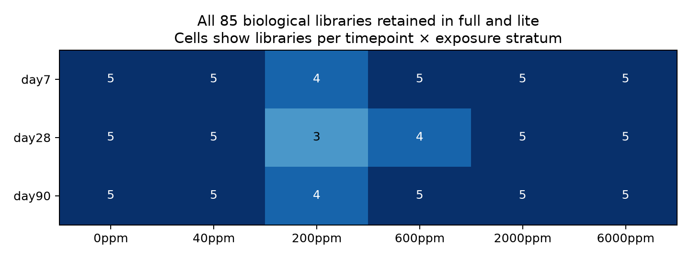
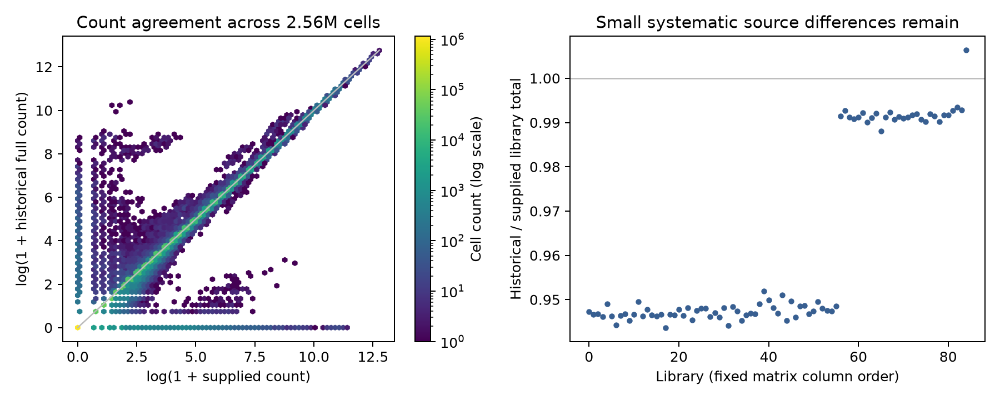

# Task 11 proxy validation

**Status: ongoing; no representative proxy has been established yet.** This directory records the study design, diagnostics and analysis tools. The final report and complete matched results will replace this status after the campaign finishes.

The practical goal is an informative evaluation taking tens of minutes, rather than a strict ten-minute timeout. The current prospective panel compares a **30-minute downstream task** with a **3-hour raw-input reference**, both on 6 vCPU / 32 GiB with GPT-5.4 mini, xhigh reasoning. Six immutable harness variants are evaluated, with an independent repeat panel if credits and time permit. A budget limit is not evidence that the task completed within that time.

The authoritative current design is [the V3 budget amendment](protocol-v3-budget-amendment.json). [V2](protocol.json) and [initial V3](protocol-v3.json) are retained as development history, rather than silently rewritten. [Methodology and research](methodology.md) explain the validation criteria and their limits.

The lite task supplies the official count matrix and omits the counting artifact from both the requirements and grade. It retains all 85 libraries, all 30,146 assay probes, every time/dose stratum and all four downstream contracts. Original metadata remain available; prepared public references and a lossless conversion of the input workbook are shared by both fidelities. This measures downstream performance conditional on supplied counts. It does not measure counting, dependency installation or the full operational history of a raw-input run.

[Input coverage and checksums](input-coverage.json) show approximately 1,153 times fewer exposed input bytes. This is data coverage evidence, **not** a demonstration that harness rankings are preserved. The same count matrix was produced by four full baseline executions, yet their downstream outcomes varied substantially.

The historical full counts are identical to one another, but differ from the supplied official counts: global log(1+count) concordance is 0.9882 and exact cell agreement is 77.2%. A fixed-method depth/source replay is planned to test how these differences propagate into differential expression. Its genes and contrasts are not independent agent trials.

Development observations already illustrate the risk of truncation: some ten- and twenty-minute runs produced no artifacts; one twenty-minute run produced only DESeq2 results. The first thirty-minute baseline computed intermediates but failed before exporting final artifacts. A thirty-minute critic run produced one of four artifacts. These observations do not establish a useful proxy, and are not pooled across preparation versions.

The primary outcome compares the **same four downstream scores** in full and lite runs. Full five-artifact score and count score are reported separately. Constant score vectors, missing paired arms, ambiguous top-two ties and unconfirmed discovery correlations cannot pass the support criteria. Infrastructure failures remain visible and are never silently converted into scientific zeros.

Implementation and reproducibility:

- [Prepared full/lite launcher](../../tools/proxy_study/launch.py): selected committed harness and prompt, explicit resource limits, protected credential streaming, isolated inputs, official artifact grading.
- [Runtime preparation](../../tools/proxy_study/prepare_vm.sh) and [functional check](../../tools/proxy_study/runtime_smoke.R): fixed R/Python image, plus synthetic DESeq2/PIANO checks before starting the actor. No fixture or answer is exposed to the actor.
- [Workbook conversion](../../tools/proxy_study/prepare_metadata.py): preserves all 89 original input sets, including the one the method requires excluding later.
- [Final usage extraction](../../tools/proxy_study/record_metrics.py): logged token costs and nested critic model calls, with reasoning tokens counted only once.
- [Matched-panel analysis](../../tools/proxy_study/analyze.py), [input plots](../../tools/proxy_study/plot_inputs.py), [trace timing export](../../tools/proxy_study/trace_summary.py), [depth replay](../../tools/proxy_study/depth_sensitivity.R), and [compute cost estimate](../../tools/proxy_study/compute_cost.py).

Raw sanitized Inspect bundles remain in the private results bucket; the final run index will identify every prefix and source commit. Credentials, remaining account balances and supplied answer matrices are not published here. API costs derived from recorded actor usage exclude separately billed network adjudication; cloud prices are estimates from resource uptime, not reconciled invoices.

The live dashboard remains [available here](https://bixdash-385251430960.us-central1.run.app/). Full and lite study scopes have separate task identifiers to avoid treating a five-artifact score as the same measure as a four-artifact score.
