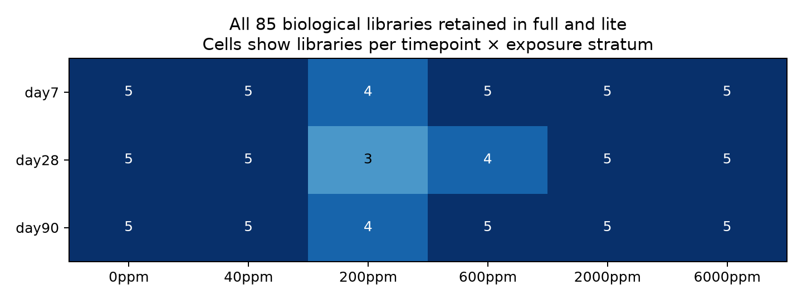
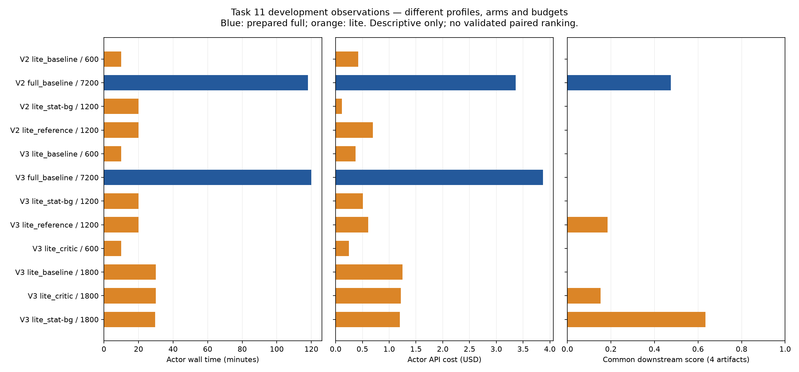
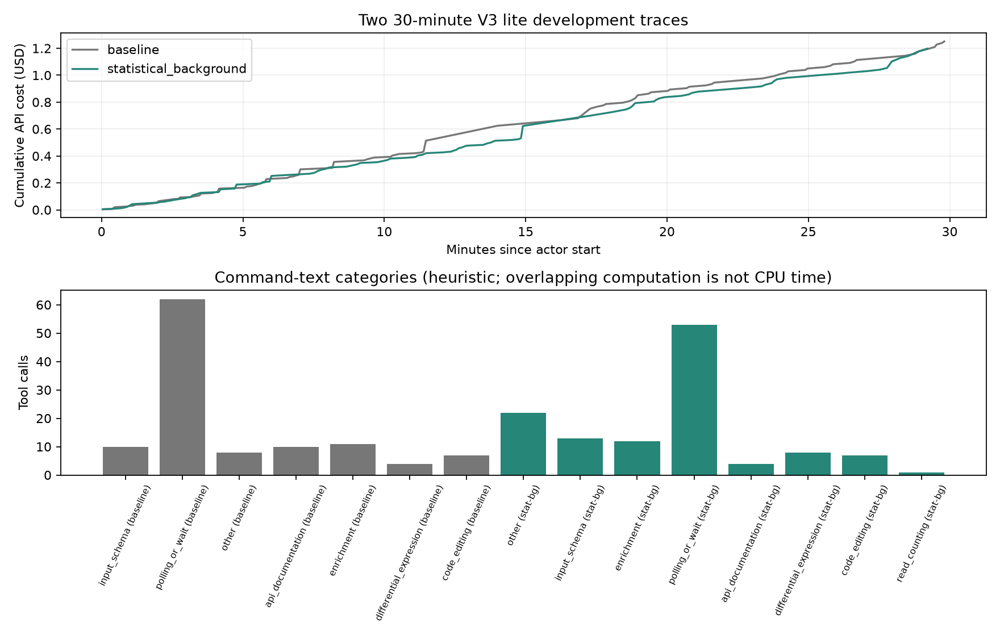
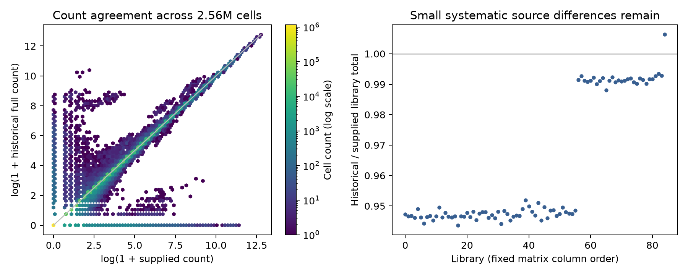

# Can a smaller task 11 stand in for the full run?

**Study closed to new experiments on 15 November 2026. Conclusion: downstream execution in tens of minutes is feasible; preservation of full-run harness rankings has not been demonstrated.** This report uses completed development observations and input/trace audits. Two already-started runs were pending at the reporting cutoff; their results are not assumed. No new experiments were launched to complete the report.

## Findings that matter

A lite development run using the statistical-background harness finished naturally in **29 min 34 s**, produced **all four downstream artifacts**, scored **0.6342**, and consumed **$1.1976 of recorded actor API usage**. This is a useful feasibility result, rather than evidence that every lite run will finish or that its score predicts the full benchmark. The same preparation version contained a metadata-helper error described below, so this observation is excluded from corrected prospective validation.

Ten-minute runs produced no final artifacts. At twenty minutes, one reference-resource variant produced a DESeq2 artifact, while other runs produced none. At thirty minutes, the baseline produced none, the critic produced one, and the statistical-background variant produced four. These are single, stochastic development observations, not a controlled estimate of the variants' relative quality. A strict ten-minute cutoff would currently measure completion and export behavior heavily.

A prepared full baseline finished in **118 min 05 s**, with five artifacts, a five-artifact score of **0.5776**, and **$3.3637** of actor API usage. Its downstream-only score was **0.4749**. Another prepared full baseline reached its two-hour limit with only the count artifact, yielding downstream score zero. Both produced the same count file. This directly illustrates why identical biological inputs do not guarantee equivalent agent behavior.

The roughly fourfold difference between the naturally finished 118-minute full run and 30-minute lite run is **descriptive**: preparation, harness variant and stochastic trajectory differ. It is not a measured paired speedup. Likewise, a three-hour versus thirty-minute budget ratio is a resource allocation choice, not evidence of sixfold acceleration.

## What was made smaller

The lite task supplies the official integer count matrix and removes the raw-read counting stage and its artifact from the prompt and grade. It retains **85 libraries, 30,146 probes, all 18 dose/time strata, the original metadata, and all four downstream output contracts**. It exposes approximately **13.73 MB instead of 15.83 GB**, a 1,153-fold reduction in input bytes. This preserves the biological design while removing an expensive operational stage; it does not make the complete task equivalent.

Both prospective fidelities use GPT-5.4 mini with xhigh reasoning on **6 vCPU / 32 GiB**, prepared R/Python packages, fixed public reference files and the selected committed harness. The full fidelity starts from the original FASTQs. The lite fidelity starts from supplied counts. Runtime preparation, synthetic functional checks, grading and transfers are outside the reported actor wall time but contribute to VM uptime.

This is a **prepared benchmark setting**, rather than an exact reproduction of the original cold environment. DESeq2 and biomaRt patch versions are 1.28.0 and 2.44.0; the historical method requested 1.28.1 and 2.44.1. Frozen official Ensembl 100 Compara/GTF resources replace the unavailable live BioMart archive. The boot disk is pd-standard; the shared input disk is pd-balanced. The process judge is disabled equally; official artifact grading remains, and network adjudication can incur separate API charges. No downstream answers are supplied to the actor.

## Results and cost accounting

[The complete run table](runs.csv) and [archive/commit index](run-index.json) records every completed study observation, its preparation profile, harness variant, time budget, usage, artifact count and score. [Cost accounting](cost-summary.json) separates completed actor API usage from a retail VM estimate. The diagnostic pilot is included in spend but excluded from scientific comparisons. Pending runs and separately billed network adjudication are not silently treated as free.

| Development observation | Actor time | API USD | Artifacts | Downstream mean |
|---|---:|---:|---:|---:|
| V2 prepared full baseline | 118.08 min | 3.3637 | 5/5 | 0.4749 |
| V3 prepared full baseline, 120-min limit | 120.03 min | 3.8737 | 1/5 | 0.0000 |
| V3 lite baseline, 10-min limit | 10.02 min | 0.3710 | 0/4 | 0.0000 |
| V3 lite reference-resource, 20-min limit | 20.02 min | 0.6081 | 1/4 | 0.1850 |
| V3 lite baseline, 30-min limit | 30.02 min | 1.2511 | 0/4 | 0.0000 |
| V3 lite critic, 30-min limit | 30.06 min | 1.2180 | 1/4 | 0.1531 |
| V3 lite statistical-background, natural finish | 29.57 min | 1.1976 | 4/4 | 0.6342 |

Time-limited runs are retained as observed scientific outcomes, including zeros when the required outputs were absent. A zero does not imply that no intermediate analysis occurred. Pre-model launch, SSH and functional-check failures are infrastructure diagnostics and are not additional zero-score experiments. Results from different preparation profiles are displayed for transparency and are not pooled for inference.

At the reporting cutoff (**15 November 2026, 13:21 PST / 21:21 UTC**), **12 completed study runs plus one diagnostic pilot** accounted for **$14.24** in actor API usage. The two study VMs accumulated **17.61 VM-hours**, estimated at **$6.40** including retained study disks and IPv4 through the cutoff. Their sum, **$20.64**, is a **partial accounted subtotal**, not an all-in invoice: it excludes actor usage from the two pending runs, broker adjudication and other services. Cloud uptime includes setup and idle time. Historical baseline runs and this Codex session are outside this study subtotal.

Actor costs use logged uncached input, cached input and output usage. Reasoning tokens are a subset of output and are not charged twice. The actor price used is $0.75 / $0.075 / $4.50 per million uncached-input / cached-input / output tokens. The successful lite development run used 108 model calls, 120 tool calls and 8,503,033 total tokens, predominantly cached context.

The Iowa retail estimate uses $0.03319155 per custom N2 vCPU-hour, $0.00444885 per GiB-hour, plus external IPv4 and retained disks. Six vCPU and 32 GiB therefore cost approximately **$0.3415 per VM-hour before disks/IP**. A 30-minute actor occupies about $0.18 of VM resources including a 200-GiB boot disk and IPv4; setup, grading and idle time add to that. Actual billing can differ. See [Compute pricing](https://cloud.google.com/products/compute/pricing/general-purpose), [disk pricing](https://cloud.google.com/compute/disks-image-pricing) and [network pricing](https://cloud.google.com/vpc/network-pricing).

## What the traces reveal

The completed Inspect logs, artifact grades and usage records are the source of truth. [Compact trace exports](trace-summaries/summary.json) and per-run model/tool CSVs expose timings and usage without copying credentials, prompts or tool-output text. Command categories are heuristics; a polling call can overlap background computation and cannot be counted as pure wasted CPU time.

| Observed bottleneck or error | Consequence | Practical implication |
|---|---|---|
| Reinstalling tools, confusing uppercase `PIANO` with the `piano` package | Setup and repeated API exploration consume actor time | Prepare fixed packages and expose accurate installed-tool information |
| Repeated `ws.cell` access on a read-only openpyxl workbook | Repeated XML parsing caused long stalls in early development | Convert metadata once and verify conversion against source rows |
| Full agent changed its Bioconductor environment while installing QuasR | A later DESeq2 results call failed with incompatible S4 classes | Separate immutable runtime preparation from actor dependency mutation |
| qAlign temporary SAM failures and an invalid probe character | Full workflow required repair/fallback counting | Lite removes this capability channel and cannot evaluate improvements to it |
| Wrong data.table ordering expressions, duplicate merge columns, missing gene-set columns, compressed input without R.utils | Downstream scripts failed and substantial work was rerun | Validate schemas and method contracts early; export artifacts incrementally |
| Final exports delayed until a large script completed | The 30-minute lite baseline had intermediates but no required artifacts | Artifact availability is a meaningful bottleneck, not only statistical runtime |

The initial pilot also exposed a Python PATH mismatch: pandas was available in the intended system interpreter but absent from a conda interpreter selected by `python`. Preparation repaired the PATH before subsequent profiles. Synthetic DESeq2/PIANO smoke checks later confirmed the immutable image was functional. These checks do not prevent an actor from breaking its own environment afterward.

## Input equivalence is helpful, but insufficient

Four inspected full-baseline count files, including historical 8-vCPU and 6-vCPU runs and two prepared study runs, were byte-identical (SHA-256 `2aef4edb2904769dc7d6615cb4f58b803b2e8d6edaded2e63c83e85e02fba385`). Their downstream results were not identical.

The supplied official counts differ slightly from those generated files: log(1+count) concordance is **0.9882**, exact entry agreement is **77.2%**, and the median library-total ratio is **0.9481**. A high global agreement does not bound changes in thresholded differential expression or enrichment results. No completed depth-thinning or fixed-method downstream sensitivity experiment is available in this study.

For a fixed program, replacing raw reads with exactly its own count matrix preserves subsequent deterministic computation. An autonomous agent also carries a conversation, package state, intermediate files and remaining budget across stages. The lite setting changes those states. It can therefore serve as a downstream development task without automatically representing end-to-end performance.

## Preparation error and validation status

A V3 workbook-to-GMT converter mishandled a blank URL: ACTA2 occupied TGxDDI's description field instead of its membership list. The original workbook was intact, but the helper represented 63 instead of 64 members in that set. This affects the evidence even though the agent still had access to the source workbook.

V4 preserves the empty description field and independently verifies all 89 sets, their ordering and membership against the workbook. The corrected GMT SHA-256 is `020d2727f516a186ff42c253d37780ab004028366593b7c36684c53418437615`. V1–V3 observations remain useful development diagnostics but are excluded from corrected V4 validation. The promising 0.6342 result belongs to V3.

The frozen V4 design planned six committed harnesses, a common four-artifact outcome, paired full/lite observations and independent confirmation. **No completed corrected matched panel or independent confirmation exists at this report's cutoff.** A corrected V4 lite baseline and an older V3 full baseline were already active when launches were stopped. They do not constitute a corrected matched pair. The run queue has been stopped and each VM has a passive finalizer to publish final usage and power off after its current run ends.

## How representativeness should be demonstrated

The relevant question is whether lite selects the same harness improvements as full. Let C be count quality and D the mean of the four downstream grades. The official full score is **F = 0.2 C + 0.8 D**; lite reports **L**, the mean over those same four downstream contracts. Compare **L with D**, rather than comparing a four-artifact score directly with a five-artifact score.

A convincing task-specific assessment would pair the same immutable harness variants across fidelities, repeat stochastic runs, separate development from confirmation, and report rank correlation, agreement on material full-performance gaps, winner retention and uncertainty. Constant zero vectors provide no ranking evidence. Individual probes, contrasts and artifacts are not independent agent replications. The registered criteria include rho ≥ 0.8, material-gap agreement ≥ 0.8, full winner in lite's top two, permutation p ≤ 0.05 and confirmation; they were **not demonstrated** here. No correlation or p-value is reported from an insufficient panel.

The deterministic identity also gives a useful error decomposition. For a reference count score c₀, predict F̂ = 0.2c₀ + 0.8L. Then |F − F̂| ≤ 0.2|C − c₀| + 0.8|D − L|. Stable counts reduce the first concern but do not control the second. An empirical bound requires matched observations; the identity alone is not a proof of proxy validity. See [methodology](methodology.md) for assumptions and small-sample limits.

## What existing research supports

[tinyBenchmarks](https://arxiv.org/html/2402.14992v2) demonstrates evaluation with curated subsets and item-response modeling on static benchmarks. Our stage-removal setting lacks the broad model-response panel that supports that calibration. It motivates calibration rather than proving this particular proxy.

[How Reliable is Language Model Micro-Benchmarking?](https://arxiv.org/html/2510.08730v1) studies whether small evaluations preserve model comparisons and emphasizes performance-gap-dependent reliability. This supports checking pairwise decisions and near ties, beyond aggregate rank correlation.

[Hyperband](https://www.jmlr.org/papers/v18/16-558.html) and [BOHB](https://proceedings.mlr.press/v80/falkner18a.html) support allocating small budgets broadly and larger budgets selectively when low fidelity is informative. They do not establish that our thirty-minute fidelity is informative. The observed time-budget points are too sparse and confounded to fit a defensible scaling law or extrapolate completion probabilities.

The biological choice to keep every library rather than drop replicates is consistent with the depth/replication trade-off investigated by [Liu et al.](https://pmc.ncbi.nlm.nih.gov/articles/PMC3904521/). Its quantitative findings do not directly transfer to TempO-Seq or autonomous-agent rankings. Read-depth reduction remains untested here.

## Recommended use of the delivered lite task

Use the corrected prepared lite task as a **downstream debugging and screening environment with a tens-of-minutes budget**. It retains realistic DESeq2, mapping and enrichment work. Prefer incremental artifact exports and schema/method checks so useful partial work survives a timeout. Keep the runtime and public references fixed when comparing harness changes.

Treat any improvement as a candidate for full evaluation. In particular, lite cannot assess read alignment/counting repairs, installation resilience or failures caused by the preceding workflow. It should not replace full end-to-end runs for reporting benchmark performance. A future matched, repeated held-out panel could establish a narrower empirical validity claim; that work was not performed after the user's stop instruction.

The delivered evidence supports a practical engineering conclusion: **preserve the cohort, remove raw-read processing, and budget around thirty minutes for iteration; retain full runs as the evaluation authority.** It does not support a general or statistical proof of representativeness.
