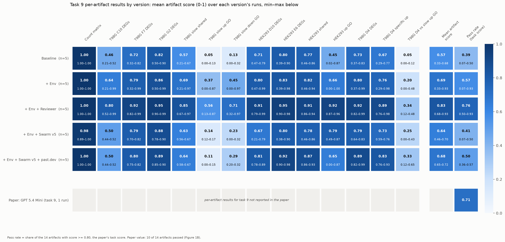
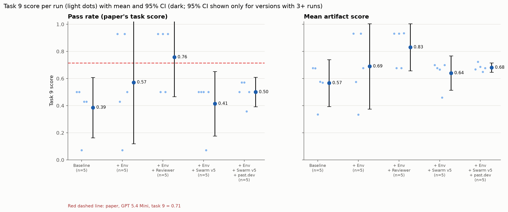

# Task 9 results: which harness changes help GPT-5.4 Mini reproduce a study?

**Task 9** (`10_1186_s12915_024_01879_0_v1`): REST loss in T98G and HEK293 cells, Tag-Seq. The agent starts from raw FASTQs and must
build 14 artifacts: a HISAT2 index and featureCounts matrix, 9 DESeq2 contrast tables, shared-gene sets and 4 GO enrichments.

**Setup for every run:** GPT-5.4 Mini at `xhigh`, official v1.0.0 prompt, 6 CPU / 32 GB (the GCP VM shape) on identical
AMD EPYC 7502 Sherlock nodes, 24 h / 5,000 messages. **5 independent runs per version**, graded by the official BixBench3
grader. The task score is the paper's: the share of the 14 artifacts with a grader score of at least 0.80.


## Summary

| Version | Branch | Task score (pass rate), mean ± 95% CI | Mean artifact score | Best / worst run | Cost / run | Time / run | Failure tags / run |
|---|---|---|---|---|---|---|---|
| Baseline | [`exp/t9-baseline`](https://github.com/timothe-chaumont/BixBench3/tree/exp/t9-baseline) | 0.39 ± 0.22 | 0.57 | 0.50 / 0.07 | $2.91 | 2.8 h | 2.4 |
| + Preinstalled env | [`exp/t9-env`](https://github.com/timothe-chaumont/BixBench3/tree/exp/t9-env) | 0.57 ± 0.45 | 0.69 | 0.93 / 0.07 | $2.08 | 1.8 h | 0.6 |
| **+ Env + Artifact reviewer** | [`exp/t9-env-reviewer`](https://github.com/timothe-chaumont/BixBench3/tree/exp/t9-env-reviewer) | **0.76 ± 0.29** | **0.83** | **0.93 / 0.50** | $2.24 | 1.8 h | 0.4 |
| + Env + Sub-agents (v4) | [`exp/t9-env-subagents`](https://github.com/timothe-chaumont/BixBench3/tree/exp/t9-env-subagents) | 0.46 ± 0.05 | 0.66 | 0.50 / 0.43 | $10.14 | 5.7 h | 1.0 † |
| + Env + Sub-agents v5 | [`exp/t9-env-subagents-v5`](https://github.com/timothe-chaumont/BixBench3/tree/exp/t9-env-subagents-v5) | 0.41 ± 0.24 | 0.64 | 0.50 / 0.07 | $3.60 | 3.4 h | 1.8 † |
| + Env + Sub-agents v5 + past.dev | [`exp/t9-env-subagents-v5-pastdev`](https://github.com/timothe-chaumont/BixBench3/tree/exp/t9-env-subagents-v5-pastdev) | 0.50 ± 0.11 | 0.68 | 0.57 / 0.36 | $3.21 | 3.5 h | 1.2 † |
| + Env + Reviewer + past.dev | [`exp/t9-env-reviewer-pastdev`](https://github.com/timothe-chaumont/BixBench3/tree/exp/t9-env-reviewer-pastdev) | 0.50 ± 0.38 | 0.66 | 0.93 / 0.07 | $2.13 | 2.3 h | 0.8 |
| + Env + Dual reviewer + past.dev | [`exp/t9-env-reviewer-dual-pastdev`](https://github.com/timothe-chaumont/BixBench3/tree/exp/t9-env-reviewer-dual-pastdev) | 0.24 ± 0.29 | 0.48 | 0.50 / 0.07 | $2.00 | 1.9 h | 0.6 |
| *+ Env + Sub-agents v4 + past.dev (1 run only)* | [`exp/t9-env-subagents-pastdev`](https://github.com/timothe-chaumont/BixBench3/tree/exp/t9-env-subagents-pastdev) | *0.50* | *0.67* | *–* | *$10.83* | *6.5 h* | *2.0 †* |
| *Paper: GPT-5.4 Mini, task 9* | – | *0.71 (one run)* | *not reported* | – | *$8.47 (mean over all 20 tasks)* | – | *3.25 (all tasks)* |

† Judged on the full logs. See [the judge blind spot](#3-the-official-process-judge-cannot-see-sub-agents) below.
The project ended on 2026-11-16 and these are the final numbers. The v4 + past.dev version (in *italics*) has a single
run, because the other 4 were cancelled when the API budget ran out. It makes no claim and is not tested. One v5 run
crashed before writing an eval log and is not counted.

**Statistics.** Exact one-sided permutation tests against the baseline (5 vs 5 runs, all 252 relabellings):

| Version | Task score | Mean artifact score |
|---|---|---|
| Reviewer | **p = 0.024** | **p = 0.012** |
| Env | p = 0.20 | p = 0.16 |
| Sub-agents (v4) | p = 0.42 | p = 0.07 |
| Sub-agents v5 | p = 0.34 | p = 0.18 |
| Sub-agents v5 + past.dev | p = 0.18 | p = 0.04 |
| Reviewer + past.dev | p = 0.22 | p = 0.17 |
| Dual reviewer + past.dev | p = 0.83 | p = 0.79 |

These are 7 tests, so only the reviewer's result should be read as a real effect. v5 + past.dev reaches p = 0.04 on one
metric only, which is weak evidence with this many comparisons.

The figures below show every run.

## What we learned

### 1. A format reviewer nearly doubles the task score, at no extra cost
Before a table goes to `outputs/`, a second call to the same model checks it against the artifact's specification. The
reviewer sees a computed summary of the file (shape, header, head and tail rows, key uniqueness, sampled identifiers). It
never sees ground truth, grader output or reference answers, and it judges format only.

- **Score:** the task score rises from **0.39 to 0.76** and the mean artifact score from 0.57 to 0.83.
- **Reliability:** no reviewer run scored below 0.50, while the baseline's worst run scored 0.07. 3 of the 5 reviewer runs
  passed 13 of 14 artifacts.
- **Cost and time:** $2.24 and 1.8 h per run, against $2.91 and 2.8 h for the baseline.
- **Versus the paper:** this is the only version whose mean is above the paper's GPT-5.4 Mini result on this task (0.71).

### 2. A preinstalled environment makes runs cheaper and cleaner, but not reliably better
Preinstalling HISAT2 2.2.1, Subread, DESeq2 1.30.1, clusterProfiler and the matching annotation packages, all first on PATH,
has three effects:

- **Cost and time:** 28% cheaper ($2.08 against $2.91) and 34% faster (1.8 h against 2.8 h).
- **Failure tags:** 2.4 per run down to 0.6. Environment-setup failures disappear.
- **Score:** spread out in both directions (0.07 to 0.93). The mean gain (+0.19) is not significant with 5 runs.

What remains after the environment is fixed is scientific choices, not tooling.

### 3. The official process judge cannot see sub-agents
The official process judge reads only the main agent's messages (`samples[0].messages`). In the sub-agent versions that
agent is the orchestrator, so the judge saw 103–189 orchestrator messages, while the sub-agents made **810–1,757 tool calls**
it never saw. The result was **0 failure tags in every v4 sub-agent run**. Over all 16 sub-agent runs, the official
judge tagged only 3.

We re-ran the same judge (same prompt, model and 120k-character budget) on the full trace rebuilt from the eval logs. Every
v4 run then gets an "inefficient analysis" tag, and 15 of the 16 sub-agent runs get at least one tag. The official `judge.json` files are left unchanged, and the re-judged results
are stored next to them as `judge_fulltrace.json`. Any benchmark that grades process from the top-level transcript will
over-credit multi-agent harnesses in the same way.

### 4. Sub-agents cost 3.5× more without improving the score
The v4 sub-agent design has an orchestrator, a dependency planner and one sub-agent per artifact. Its runs are the most
consistent (pass rate 0.43–0.50) but cost **$10.14 per run**, and the score does not improve. We traced where the money went
in a $8.88 run:

- **Polling:** **$3.18 (36%) went on 268 status checks** while `hisat2-build` ran for about an hour. Each check is a full
  xhigh-reasoning model call that re-reads a context of about 150k tokens.
- **Per-agent overhead:** about $1.5. Every new sub-agent starts with an empty context, so it re-reads the brief, the files
  and the environment manifest.
- **Duplicates and planning:** $0.34 on two artifacts the orchestrator rebuilt although they were already valid, and $0.48
  on the planner.

These findings shaped **v5** (blocking waits, no rebuilding valid artifacts, parallel dependency levels, sub-agents at
`medium` effort, no planner) and a **past.dev run memory**, so that sub-agents share what earlier agents found.

**Final v5 results (5 runs each):**

- **Cost and time:** cost drops from $10.14 to **$3.60 (v5)** and **$3.21 (v5 + past.dev)**, about 3× cheaper. Time drops
  from 5.7 h to about 3.4 h.
- **v5 alone:** the score stays at the v4 level (mean artifact score 0.64 against 0.66). The v4 stability is lost: one run
  fell to 0.46.
- **v5 + past.dev:** with the shared memory, the stability comes back (0.649 to 0.723, mean 0.68), and this is the best
  sub-agent version.

The cost fixes work, but sub-agents still do not beat the single-agent reviewer (0.83 at $2.24).

### 4b. past.dev shared memory: it helps the swarm, not the single agent

[past.dev](https://past.dev) is a run-scoped memory service, used in two ways:

- **In the swarm:** every agent's inspections, files, conventions and lessons are stored as cards. Before each sub-agent
  starts, past.dev ranks the cards against its brief and hands it a context pack of about 10k characters.
- **In the reviewer:** the reviewer gets the summaries of the tables it already accepted.

Each pair below differs only by past.dev. The memory logs confirm that past.dev answered in every run (0 ranking
fallbacks).

| Pair (5 vs 5 runs) | Mean artifact score | Run-to-run SD | Cost / run | Model calls | Tool calls | Sub-agents | Memory cards / run |
|---|---|---|---|---|---|---|---|
| Swarm v5 → **v5 + past.dev** | 0.640 → **0.681** (+6%) | 0.091 → **0.025** (3.6× tighter) | $3.60 → **$3.21** (−11%) | 834 → 702 (−16%) | 913 → 742 (−19%) | 49 → 41 | 176–282 |
| Reviewer → Reviewer + past.dev | **0.830** → 0.663 (−20%) | 0.125 → 0.191 | $2.24 → $2.13 (−5%) | 245 → 181 | 253 → 179 | – | 14 |
| Reviewer → Dual reviewer + past.dev | **0.830** → 0.481 (−42%, p = 0.02) | 0.125 → 0.161 | $2.24 → $2.00 | – | – | – | 51–63 |
| *Swarm v4 → v4 + past.dev (1 run)* | *0.664 → 0.667* | *–* | *$10.14 → $10.83* | *1,118 → 1,112* | *1,207 → 1,202* | *51 → 37* | *424* |

**What the data show.** Used with the v5 swarm, past.dev does not cost extra. The swarm gets slightly better, much more
stable, and cheaper at the same time:

- **Fewer calls:** 16% fewer model calls and 19% fewer tool calls, about 11% cheaper.
- **Fewer sub-agents:** fewer were spawned.
- **Stability:** this is the clearest effect. All 5 runs fall between 0.649 and 0.723.

With the single-agent reviewer the memory gives no gain, and the score drops.

**Caveats:**

- **Significance:** with 5 runs per arm, none of the swarm differences is significant on its own (score p = 0.62,
  cost p = 0.34, two-sided). They all point the same way, and the variance drop is large.
- **v4 + past.dev was exploratory:** we were still working out how to wire past.dev into the orchestrator, and only 1
  of 5 runs finished before the API budget ran out. We draw no conclusion from it.
- **The reviewer arms test a different use:** there the memory feeds a tool-less format reviewer, not the agent doing the
  work.

**Our hypothesis.** How much a shared memory helps depends on the ratio of two things:

- the context the task needs to carry, meaning facts, file layouts, conventions and upstream results;
- the context the model can hold while still working well.

In the swarm, every sub-agent starts with an empty context, so knowledge must travel between agents. Without memory they
re-read it: in a v4 run, 17 of 17 agents re-inspected the environment manifest. They also miss shared conventions,
which caused 2 tables to be rebuilt. Here the need is far larger than what each agent holds, and past.dev fills the gap
with a compact, ranked pack. The v5 swarm runs filled past.dev with 176–282 cards each.

A single agent, with or without a reviewer, already holds the whole run in one context. Task 9 fits in GPT-5.4 Mini's
context, so the memory adds little: the reviewer stored only 14 cards per run. It also adds a constraint, matching earlier
tables, which seems to have made the reviewer reject or reshape tables that were fine.

The hypothesis predicts two things we could not test in time:

- **Longer tasks:** larger gains on longer or multi-paper tasks, and for single agents whose context fills up.
- **Larger contexts:** smaller gains with models that have a larger effective context.

### 5. One ambiguous sentence in the prompt drives most of the error left in the T98G artifacts
The count matrix is correct (score 1.00) in **every** run. The T98G differential-expression and GO artifacts then split by
a single modelling choice. The prompt says *"Run DESeq2 … separately by cell line and clone contrast"*, which agents read
in two ways:

| How the agent fits DESeq2 | C10 DEGs | D4 DEGs | D4-vs-slow GO |
|---|---|---|---|
| One model per cell line (all 10 T98G samples), one contrast per clone | 0.99 | 0.98 | 0.40–0.48 |
| A separate 2-vs-2 model for each comparison | 0.44–0.52 | 0.75–0.83 | 0–0.13 |
| As above, but samples filtered on condition only, so HEK293 controls leak into T98G (agent bug) | 0.21 | 0.37 | 0 |

The reference was built the first way. With only 2 vs 2 samples, DESeq2 estimates dispersion poorly and about 25% fewer
genes reach significance. The error then compounds through D4 DEGs, the shared slow-clone set, D4-specific genes and D4 GO.
This is why **"T98G D4 vs slow up GO" is the weakest artifact in every version** (heatmap below).

We did **not** add a hint to the prompt. It would come too close to giving the answer. This is a property of the benchmark
item worth reporting.

## Figures

The figures show the five versions of the landing-page story: baseline, + env, + reviewer, + swarm v5 and + swarm v5 +
past.dev. The summary table above also keeps the exploratory versions: v4, the reviewer variants with memory and v4 +
past.dev.

**Per-artifact scores** (mean, min–max underneath; cf. paper Supp. Fig. 4B). The reviewer improves almost every column,
most strongly the T98G DE tables and the GO enrichments. The count matrix is solved in every run.



**Task score per run, with mean and 95% CI.** Left: pass rate, the paper's score. Right: mean artifact score. 



**Process-judge failure modes per run** (cf. paper Fig. 5A–B). The environment removes setup failures, and the reviewer
leaves only occasional "inefficient analysis" tags. † marks the full-trace re-judge.


**Cost against score** (complete versions only). The reviewer version sits in the top-left corner: higher score, low cost.


**Cost and wall time per run.**


Also: [pass frequency per artifact](figures/fig_C_heatmap_pass_frequency.png) and [summary table](figures/summary.md).
PDFs sit next to each PNG.

## What the later versions changed

| Version | Branch | Idea |
|---|---|---|
| + Env + Reviewer + past.dev | [`exp/t9-env-reviewer-pastdev`](https://github.com/timothe-chaumont/BixBench3/tree/exp/t9-env-reviewer-pastdev) | The reviewer also sees the tables it already accepted in this run, for cross-table format consistency |
| + Env + Dual reviewer + past.dev | [`exp/t9-env-reviewer-dual-pastdev`](https://github.com/timothe-chaumont/BixBench3/tree/exp/t9-env-reviewer-dual-pastdev) | Local reviewer plus a consistency reviewer with a rolling run memory; both must accept |
| + Env + Sub-agents v5 | [`exp/t9-env-subagents-v5`](https://github.com/timothe-chaumont/BixBench3/tree/exp/t9-env-subagents-v5) | The cost fixes from finding 4 |
| + Env + Sub-agents + past.dev | [`exp/t9-env-subagents-pastdev`](https://github.com/timothe-chaumont/BixBench3/tree/exp/t9-env-subagents-pastdev) | v4 plus a shared past.dev memory of inspections, files and conventions (1 run; the rest were cancelled when the API budget ran out) |
| + Env + Sub-agents v5 + past.dev | [`exp/t9-env-subagents-v5-pastdev`](https://github.com/timothe-chaumont/BixBench3/tree/exp/t9-env-subagents-v5-pastdev) | Both of the above |

## Method notes and caveats

- **Run counting:** only runs that completed normally are counted. Smoke tests, and 13 runs lost to an API rate limit
  and a relay outage in the first hour of the night batch, are excluded. Every completed run is
  included, whatever its score.
- **Paper reference:** the paper reports one GPT-5.4 Mini attempt on task 9: 10 of 14 artifacts passed (Fig. 1B), which
  is 0.71. It does not say which artifacts passed, so that heatmap row is left empty. Its failure-mode counts and its $8.47
  cost are means over all 20 tasks, not task 9 alone. No paper number here is estimated.
- **Why GPT-5.4 Mini:** it is a cheap model, so 5 repeats per version fit the budget. With this much run-to-run spread,
  single runs would be misleading.
- **Platform parity:** our Sherlock task 9 baseline (0.566 mean artifact score) matches the team's GCP reference run
  (0.575), so the cluster does not bias the comparison.

## Reproduce the figures

```bash
cd results/task9
./update_data.sh   # pulls completed runs from Sherlock into data/runs.jsonl (needs `ssh sherlock`)
uv run --no-project --with matplotlib python make_figures.py
uv run --no-project --with matplotlib python make_headline.py
```

`data/runs.jsonl` holds one record per completed run: grades, per-artifact scores, judge tags, tokens, cost and time. It
contains no credentials, prompts or transcripts.
